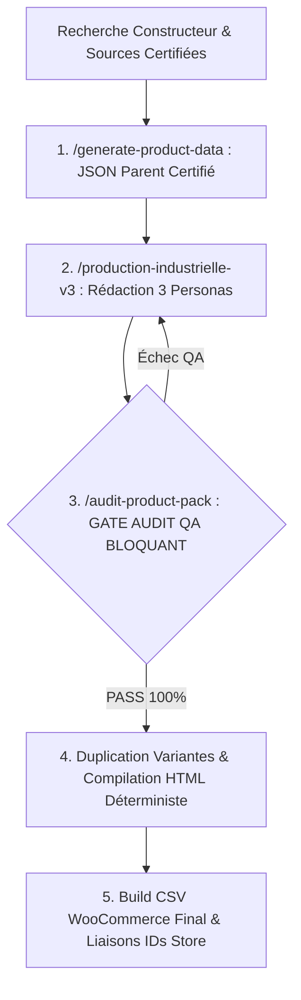

# 🤖 Système Industriel & Écosystème Agentique My-eStore (V3.4)

> **Plateforme E-Commerce WordPress & WooCommerce — Marché Côte d'Ivoire (Prix FCFA)**  
> **Architecture Normative :** V3.4 *Parent-First Audit Gate* | **Gouvernance :** [AGENTS.md](AGENTS.md)

[](.)
[](.)
[](.)
[-success.svg)](.)
[](.)

---

## 🏆 Chiffres Clés Consolidés & Métriques d'Impact

Le système a transformé une gestion artisanale manuelle en une véritable **usine de production industrielle automatisée et déterministe**.

```
┌─────────────────────────────────────────────────────────────────────────────┐
│                          RÉSULTATS MAJEURS DE L'USINE                       │
├────────────────────────────────┬────────────────────────────────────────────┤
│ 📄 Fiches HTML Générées         │ 5 148 Fichiers (Longues + Courtes)         │
│ 🧠 Modèles Parents Certifiés   │ 379 Fichiers JSON Sources de Vérité (PIM)  │
│ 📦 Total Packs Données JSON     │ 1 347 Fichiers JSON Structurés             │
│ 🛒 Catalogues Exports CSV       │ 82 CSV WooCommerce prêts à l'import        │
│ 🏷️ Lignes Produits Exportées    │ 1 597+ Variantes & Parents avec SKUs       │
│ 🏷️ Marques Couvertes            │ 25+ Marques Internationales Leaders        │
│ 🛠️ Scripts & Outils Python      │ 54 Scripts d'Audit, Génération & Pipeline  │
│ 🗂️ Catégories Store Mappées     │ 127 Catégories Hiérarchiques WooCommerce   │
│ 💰 Matrices Tarifaires FCFA     │ 50+ Grilles de Prix Dynamiques (Pricing/)  │
│ 📐 Templates Métiers Créés      │ 9 Gabarits Déterministes Spécialisés       │
│ 🎯 Taux de Conformité AIOSEO    │ 100% sur les lots audités (Formule 15/41)  │
│ 🛡️ Taux d'Erreur Cartésienne    │ 0% (Élimination via paired_variants)       │
│ 📉 Gain de Masse Salariale      │ -70% par rapport à une équipe de saisie    │
│ ⚡ Gain de Temps de Production   │ > 98% (30h vs 2 500h pour 1 000 fiches)     │
└────────────────────────────────┴────────────────────────────────────────────┘
```

---

## 📋 Table des Matières

1. [Architecture V3.4 (Parent-First Audit Gate)](#-1-architecture-v34-parent-first-audit-gate)
2. [Cartographie des 5 Agents Spécialisés](#-2-cartographie-des-5-agents-spécialisés)
3. [Les 3 Personas Industriels](#-3-les-3-personas-industriels)
4. [Répertoires et Fichiers Clés du Système](#-4-répertoires-et-fichiers-clés-du-système)
5. [Standards de Qualité & Règles d'Or](#-5-standards-de-qualité--règles-dor)
6. [Quick Start & Commandes Opérationnelles](#-6-quick-start--commandes-opérationnelles)
7. [Catalogue des Marques Déployées](#-7-catalogue-des-marques-déployées)
8. [Pipelines Documentés & Références](#-8-pipelines-documentés--références)

---

## 🗺️ 1. Architecture V3.4 (Parent-First Audit Gate)

L'innovation maîtresse de la version **V3.4** réside dans le principe du **Parent-First Audit Gate** :  
Tous les contrôles qualité techniques, sémantiques et SEO sont exécutés **sur le Modèle Parent (`product-data/`) AVANT toute duplication de variante**.  

Cette approche élimine 100% de la réplication d'erreurs sur les fiches filles :



---

## 🤖 2. Cartographie des 5 Agents Spécialisés

L'usine agentique est articulée autour de rôles strictement découplés :

| Slash Command | Persona & Responsabilité | Workflow Associé |
| :--- | :--- | :--- |
| **`/master-orchestrator`** | **Chef d'Atelier V3.4** : Orchestre l'ensemble de la chaîne de production de bout en bout (Data ➔ Rédaction ➔ QA ➔ Build). | [.agents/workflows/master-orchestrator.md](.agents/workflows/master-orchestrator.md) |
| **`/generate-product-data`** | **Agent Investigateur** : Extrait et normalise les données techniques constructeurs dans les JSON parents sources de vérité. | [.agents/workflows/generate-product-data.md](.agents/workflows/generate-product-data.md) |
| **`/production-industrielle-v3`** | **Master Router V3.4** : Pilote la rédaction séquentielle des 3 Personas sur le JSON parent certifié. | [.agents/workflows/production-industrielle-v3.md](.agents/workflows/production-industrielle-v3.md) |
| **`/audit-product-pack`** | **Agent QA Checker** : Gatekeeper bloquant. Valide l'absence d'hyperboles, la formule AIOSEO 15/41 et les SKUs. | [.agents/workflows/audit-product-pack.md](.agents/workflows/audit-product-pack.md) |
| **`/script-specialist`** | **Technicien Python** : Seul agent autorisé à modifier, débugger et exécuter les scripts Python du système. | [.agents/workflows/script-specialist.md](.agents/workflows/script-specialist.md) |
| **`/produce-appliance`** | **Maker Électroménager** : Production industrielle spécialisée pour le Gros & Petit Électroménager et la Climatisation. | [.agents/workflows/produce-appliance.md](.agents/workflows/produce-appliance.md) |

---

## 🎭 3. Les 3 Personas Industriels

Afin de garantir un contenu haut de gamme, sans blabla marketing ni dérive algorithmique, la rédaction applique séquentiellement 3 rôles :

### ✍️ Persona 1 : Copywriter Factualité Dynamique & Usage Quotidien
* **Zéro Hyperbole** : Proscription formelle des termes pompeux (*"ultime"*, *"révolutionnaire"*, *"inégalé"*, *"exceptionnel"*).
* **Calibrage par Gamme** : Registre adapté aux attentes réelles du client :
  * *Entrée de gamme* : Fiabilité pratique, simplicité d'accès, robustesse, autonomie.
  * *Milieu de gamme* : Polyvalence, fluidité multimédia (90Hz/120Hz), rapport qualité/prix.
  * *Flagship / Haut de gamme* : Précision des composants, puissance brute, finitions premium (titane, IP68).
* **Pureté de l'Introduction** : Focus 100% produit dans l'`intro_paragraph` (interdiction des mentions promotionnelles de réassurance boutique).

### 🔍 Persona 2 : Expert SEO AIOSEO
* **Formule Fixe 15/41 (36.5%)** : 15 phrases avec mots de transition sur 41 pour un score optimal AIOSEO (cible 31% à 49%).
* **Fluidité Syntaxique (Fin du Métronome)** : Connecteurs logiques insérés au cœur des propositions (*"...assure par conséquent..."*, *"...permet ainsi de..."*).
* **Longueur des Phrases** : 100% de phrases courtes (≤ 20 mots, 0% de phrases longues tolérées).
* **SEO Meta Titles Standard B** :
  * `short_description.seo.meta_title` : `Acheter [MARQUE] [MODÈLE] ([RAM]/[ROM]) à Abidjan | My-eStore` (50-60 car.)
  * `long_description.seo.meta_title` : `[MARQUE] [MODÈLE] [ROM] : [Top Spec 1] & [Top Spec 2] | My-eStore`
  * `long_description.h1` : `[MARQUE] [MODÈLE] : [Top Spec 1], [Top Spec 2] et [Top Spec 3]`
* **10 à 14 Tags WooCommerce Enrichis** : Bloc dense et géolocalisé (Marque, Modèle, Gamme, Réseau, Écran, SoC, Batterie, Abidjan, My-eStore).

### ⚙️ Persona 3 : Intégrateur & Auditeur QA
* **Standard `paired_variants`** : Couplage strict des configurations réelles (RAM/ROM/Couleur). Interdiction du produit cartésien aveugle.
* **Règle Stricte des 3 Liens Sources** : 1 lien officiel constructeur + 2 requêtes de recherche neutres. **0 lien sortant vers des concurrents**.
* **Attributs WooCommerce Ordre Officiel** :
  1. `Couleur` | 2. `Stockage` | 3. `RAM` | 4. `Processeur` *(PC)* ou `Poids` *(format `X.XXX kg`)* | 5. `Réseau`.

---

## 📂 4. Répertoires et Fichiers Clés du Système

```
wordpress/
├── AGENTS.md                                # Charte d'Excellence & Source de Vérité V3.4
├── Categories_produits_du_store.csv         # Taxonomie officielle (127 catégories store)
│
├── product-data/                            # CŒUR PIM : 379 Fiches Parents JSON Certifiées
│   ├── xiaomi/                              # (Flagships, Poco, Redmi Note, Pad)
│   ├── samsung/                             # (Galaxy S, Z Fold/Flip, Galaxy A, Tab, Watch)
│   ├── blackview/                           # (Séries BV/BL, Shark, Color, Tab, Active)
│   ├── apple/                               # (iPhone 11 à 16 Pro Max, iPad, Watch, Mac)
│   └── ...                                  # (HiFuture, Google Pixel, Honor, ZTE, etc.)
│
├── products/                                # USINE DE COMPILATION TECH (Packs HTML & JSON)
│   └── [marque]-[série]/[variante]/         # long-*.html, short-*.html, pack-data-*.json
│
├── products-appliance/                      # USINE GROS & PETIT ÉLECTROMÉNAGER
│   └── [marque]/                            # (Nasco, Hisense, Midea, Beko, TCL, etc.)
│
├── Templates/                               # 9 GABARITS MÉTIERS STRUCTURELS
│   ├── Template_Pack_v2_smartphone.json     # Smartphones & Téléphonie
│   ├── Template_Pack_v2_appliance.json      # Électroménager & Climatisation
│   ├── Template_Pack_v2_pc_portable.json    # Laptops & PC Bureau
│   ├── Template_Pack_v2_wearable.json       # Montres & Bracelets connectés
│   ├── Template_Pack_v2_audio.json          # Casques & Écouteurs sans fil
│   ├── TEMPLATE_LONG.html                   # Rendu HTML responsive description longue
│   └── TEMPLATE_SHORT.html                  # Rendu HTML épuré description courte
│
├── Pricing/                                 # 50+ MATRICES DE PRIX & CONVERSIONS EN FCFA
│   ├── price_map_*.json                     # Tables de correspondances de prix Côte d'Ivoire
│   └── Pricing_*.xlsx                       # Grilles de calcul des majorations de stockage
│
├── pipelines/                               # STANDARDS OPÉRATIONNELS FORMALISÉS
│   ├── pipeline_production_v3.4_Parent-First_Audit_Gate.md
│   ├── pipeline_liaison_id_v3.4.md          # Réconciliation à 4 niveaux des IDs Store
│   └── pipeline_mise_a_jour_categories_v3.4.md
│
├── scripts/                                 # 54 OUTILS & SCRIPTS PYTHON D'AUTOMATISATION
│   ├── build-product-pack-v2.py             # Compilateur JSON ➔ HTML + CSV
│   ├── rebuild_[marque]_catalog.py          # Scripts de reconstruction massive de catalogue
│   ├── copywriting_remediation.py           # Détecteur & assainisseur d'hyperboles
│   └── tools/data_processing/               # Outils d'audit AIOSEO & vérification de structure
│
└── .agents/                                 # ÉCOSYSTÈME DES WORKFLOWS & SKILLS IA
    ├── workflows/                           # Fichiers de guidage des 5 agents spécialisés
    └── skills/                              # Compétences métier (AIOSEO, PIM, Remediation)
```

---

## 🚨 5. Standards de Qualité & Règles d'Or

1. **Interdiction Formelle du Procédural Scripté** : Il est strictement interdit d'utiliser des scripts pour générer à la chaîne du texte marketing sans âme. La rédaction doit être unitaire, réfléchie et adaptée au produit.
2. **Le Tableau `full_specs` est DANS la Description Longue** : Positionné immédiatement au-dessus des boutons CTA.
3. **Poids Obligatoire en Kilogrammes** : Renseigné sous `Attribute 4 name`: `"Poids"`, `Attribute 4 value(s)`: `"{poids} kg"`.
4. **Zéro Lien Vers les Concurrents** : Seules les 3 sources standardisées (Boutique constructeur + 2 requêtes neutres) sont admises.
5. **Idempotence & Zéro Doublon** : Grâce à `link_store_ids_v3.4.py`, les ré-imports mettent à jour les fiches existantes sans altérer l'indexation SEO existante.

---

## ⚡ 6. Quick Start & Commandes Opérationnelles

### A. Auditer un Modèle Parent (Vérification QA Bloquante)
```bash
# Vérifier la conformité de structure JSON V3.4
python scripts/tools/product_data/audit_json_structure.py --dir "product-data/xiaomi"

# Vérifier le score AIOSEO et la formule 15/41
python scripts/tools/data_processing/audit_batch_aioseo.py --dir "product-data/xiaomi"

# Détecter et nettoyer les éventuelles hyperboles
python scripts/copywriting_remediation.py detect --products-dir "product-data/xiaomi"
```

### B. Compiler un Modèle ou Reconstruire un Catalogue Complet
```bash
# Compiler un pack individuel vers HTML & CSV
python scripts/build-product-pack-v2.py --data "product-data/xiaomi/poco/poco-f7.json" --outdir "products/poco-f7" --modele "poco-f7"

# Reconstruire tout le catalogue d'une marque (exemple Xiaomi)
python scripts/rebuild_xiaomi_catalog.py
```

### C. Réconcilier les IDs avec le Store en Ligne
```bash
# Lier les identifiants WooCommerce existants pour éviter les doublons
python scripts/link_store_ids_v3.4.py --csv "products/import-v2-xiaomi.csv"
```

---

## 🏷️ 7. Catalogue des Marques Déployées

| Pôle | Marques Traitées & Validées | Volumes |
| :--- | :--- | :---: |
| **High-Tech & Mobilité** | Xiaomi, Redmi, Poco, Samsung Galaxy, Apple, Blackview, Oscal, ZTE, Nubia, RedMagic, Google Pixel, HiFuture, Honor, Huawei, Infinix, Tecno, Itel, Oukitel, Oraimo, SanDisk, Black Shark. | **2 551 Fiches HTML** <br>(379 Parents PIM) |
| **Électroménager & Froid** | Nasco, Hisense, Midea, Samsung Appliance, TCL, Beko, Toshiba, Carrier, Philips, Electrolux, Unionaire, Galaxy Appliance. | **2 588 Fiches HTML** <br>(191 Catégories) |
| **Gaming** | Sony PlayStation (PS4 Slim, PS4 Pro, Manettes & Jeux). | **9 Fiches HTML** |

---

## 📚 8. Pipelines Documentés & Références

* [Charte d'Excellence & Système Agentique V3.4](AGENTS.md)
* [Rapport d'Audit Final & Bilan Consultant Content Manager](Docs/CV/fiche_projet_cv.md)
* [Étude Comparative d'Effort : Manuel vs Agentique](Docs/rapport-comparatif-effort-humain-vs-ia.md)
* [Pipeline V3.4 Parent-First Audit Gate](pipelines/pipeline_production_v3.4_Parent-First_Audit_Gate.md)
* [Taxonomie des Catégories Store](Categories_produits_du_store.csv)

---

<div align="center">

**Système Industriel E-Commerce My-eStore**  
*Ingénierie de Contenu PIM • Norme V3.4 Parent-First • 100% Déterministe*

</div>
