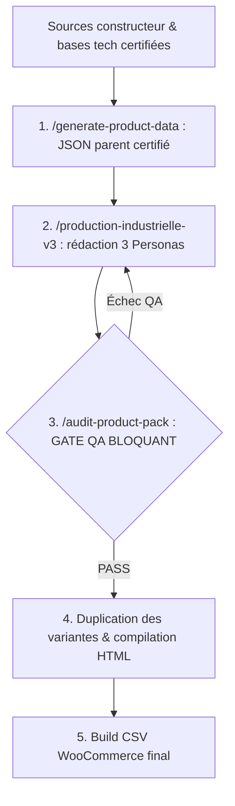

# 🤖 Système Industriel & Écosystème Agentique (V3.4)

> **Plateforme E-Commerce WordPress & WooCommerce**  
> **Architecture Normative :** V3.4 *Parent-First Audit Gate* | **Gouvernance :** [AGENTS.md](AGENTS.md)

[](.)
[](.)
[](requirements.txt)

Workflow de production de fiches produits WooCommerce pilotée par des agents IA via un IDE Agentique (Claude Code, Antigravity, Codex, VSode, etc.).
Le dépôt sépare l'**intelligence produit** (JSON parents certifiés, source de vérité) de la **production marketing** (HTML long/court + CSV d'import WooCommerce).

---

## 📋 Table des Matières

1. [Architecture V3.4 (Parent-First Audit Gate)](#️-1-architecture-v34-parent-first-audit-gate)
2. [Workflows Agentiques](#-2-workflows-agentiques)
3. [Les 3 Personas Industriels](#-3-les-3-personas-industriels)
4. [Normes JSON V3.4](#-4-normes-json-v34)
5. [Structure du Dépôt](#-5-structure-du-dépôt)
6. [Installation & Commandes](#-6-installation--commandes)
7. [Règles d'Or](#-7-règles-dor)
8. [Références](#-8-références)

---

## 🗺️ 1. Architecture V3.4 (Parent-First Audit Gate)

Tous les contrôles qualité (techniques, éditoriaux, SEO) sont exécutés **sur le modèle parent (`product-data/`) AVANT toute duplication de variante**.
Une erreur corrigée sur le parent ne se réplique donc jamais sur les déclinaisons.



---

## 🤖 2. Workflows Agentiques

Orchestrés par `/master-orchestrator`, les workflows sont définis dans [.agents/workflows/](.agents/workflows/).

| Slash Command | Rôle | Fichier |
| :--- | :--- | :--- |
| **`/master-orchestrator`** | Chef d'Atelier : orchestre la chaîne Data ➔ Rédaction ➔ QA ➔ Duplication ➔ CSV | [master-orchestrator.md](.agents/workflows/master-orchestrator.md) |
| **`/production-industrielle-v3`** | Master Router : rédaction des 3 Personas sur le JSON parent (Tech & Appliance) | [production-industrielle-v3.md](.agents/workflows/production-industrielle-v3.md) |
| **`/generate-product-data`** | Agent Investigateur : extraction et validation des données techniques certifiées | [generate-product-data.md](.agents/workflows/generate-product-data.md) |
| **`/audit-product-pack`** | Agent QA Checker : audit strict des JSON et exécution des scripts de validation | [audit-product-pack.md](.agents/workflows/audit-product-pack.md) |
| **`/script-specialist`** | Technicien : seul agent habilité à créer ou débugger les scripts Python | [script-specialist.md](.agents/workflows/script-specialist.md) |
| **`/produce-appliance`** | Maker Électroménager : production des fiches Gros/Petit Électroménager & Climatisation | [produce-appliance.md](.agents/workflows/produce-appliance.md) |
| **`/WORKFLOW_COMPLET`** | Carte d'État-Major de l'usine agentique | [WORKFLOW_COMPLET.md](.agents/workflows/WORKFLOW_COMPLET.md) |

Compléments :

- **Sous-workflows** : [copywriting_rules_v3.md](.agents/workflows/sub_workflows/copywriting_rules_v3.md), [build_remediation_rules_v3.md](.agents/workflows/sub_workflows/build_remediation_rules_v3.md)
- **Directive constitutionnelle** : [VERIFICATION_IMPERATIVE.md](.agents/directives/VERIFICATION_IMPERATIVE.md) (vérification obligatoire des données produits)
- **Skills métier** ([.agents/skills/](.agents/skills/)) : `aioseo-verification`, `appliance-factory`, `content-quality-validator`, `copywriting-remediation`, `product-intelligence`
- **Skills à usage restreint** : `autonomous-agents`, `content-creator`, `prompt-engineering`, `rag-engineer`

---

## 🎭 3. Les 3 Personas Industriels

Ils interviennent séquentiellement sur le modèle parent (détail complet dans [AGENTS.md](AGENTS.md#-3-rôles-et-responsabilités-des-3-personas-industriels)).

### ✍️ Persona 1 : Copywriter Factualité Dynamique & Usage Quotidien
- **Zéro hyperbole** : termes comme *"ultime"*, *"révolutionnaire"*, *"inégalé"*, *"exceptionnel"* sont proscrits.
- **Ton calibré par gamme** :
  - *Entrée de gamme* : simplicité, fiabilité, robustesse, maîtrise du budget.
  - *Milieu de gamme* : polyvalence, réactivité, confort multimédia, rapport performance/prix.
  - *Haut de gamme* : composants de pointe, productivité exigeante, durabilité des matériaux.
- **Contextualisation par typologie** : smartphones, PC/tablettes, audio & montres, électroménager.
- **Pureté de l'introduction** : aucune mention promotionnelle boutique dans `intro_paragraph`.

### 🔍 Persona 2 : Expert SEO AIOSEO
- **Phrases ≤ 20 mots** (0 % de phrases longues).
- **Transitions entre 30 % et 50 %**, formule cible **15/41 (36,5 %)** : 3 dans l'intro, 4 par section H2.
- **Fluidité syntaxique** : connecteurs placés au cœur des propositions, pas en début systématique.
- **Orthographe** : `My-eStore` (sans espace).
- **Titres Standard B** :
  - `short_description.seo.meta_title` : `Acheter [MARQUE] [MODÈLE] ([RAM]/[ROM]) à Abidjan | My-eStore` (50-60 car.)
  - `long_description.seo.meta_title` : `[MARQUE] [MODÈLE] [ROM] : [Top Spec 1] & [Top Spec 2] | My-eStore` (50-60 car.)
  - `long_description.h1` : `[MARQUE] [MODÈLE] : [Top Spec 1], [Top Spec 2] et [Top Spec 3]`
- **Volumes** : description longue 450-650 mots, intro ≤ 100 mots, paragraphes H2 de 45-60 mots.
- **Tags WooCommerce** : 10 à 14 tags dédoublonnés (Marque, Modèle, Série, Typologie/OS, Réseau, Écran, Photo, Batterie, Chipset, Points forts, `Abidjan`, `My-eStore`).

### ⚙️ Persona 3 : Intégrateur & Auditeur QA
- **Unicité stricte des SKUs** et exactitude des métadonnées.
- **Gate bloquant `paired_variants`** : conformité aux configurations officielles, aucune variation cartésienne fantôme.
- **Audit Python** : `validate_product_data.py`, `audit_aioseo_sentences.py`, `copywriting_remediation.py`.
- **Rendu HTML sans warning** : tous les placeholders `<!-- SPEC_* -->` renseignés.

---

## 📐 4. Normes JSON V3.4

S'appliquent aux JSON parents, aux `pack-data-*.json` et aux `Templates/Template_Pack_v3_*.json`.

| Règle | Exigence |
| :--- | :--- |
| Version | `"template_version": "3.4"` |
| Tableau de specs | `full_specs` (Tech) ou `full_specs_table` (Appliance) **dans** `long_description`, juste au-dessus de `cta` |
| CTA | `top_link: "#"`, `top_label: "Remonter pour commander"`, `boutiques_link: "https://my-estore.com/boutiques-officielles/"`, `boutiques_label: "Nos Boutiques Officielles"` |
| Attributs WooCommerce | 1 `Couleur` · 2 `Stockage` · 3 `RAM` · 4 `Processeur` (PC) ou `Poids` (`X.XXX kg`) · 5 `Réseau` |
| Déclinaisons | Bloc `paired_variants` à la racine dès la création du parent si les couples RAM/ROM/Couleur sont dépendants ; attributs 1-3, `ram_options` et `storage_options` strictement synchronisés |
| Sources | Exactement 3 : `[MARQUE] Official Store` (page produit officielle), `Recherche Générique` (Google), `Recherche Spécialisée IA` (Google + `specifications`) — aucun lien vers des sites tiers |

Exemple de déclinaison couplée :

```json
"paired_variants": [
    {
        "color_fr": "Noir",
        "color_en": "Obsidian Black",
        "color_code": "NOIR",
        "ram": "12 Go",
        "storage": "512 Go",
        "price": "550000",
        "sku_suffix": "512GB-12GB-NOIR"
    }
]
```

---

## 📂 5. Structure du Dépôt

```
AI-Content-Management-workflow/
├── AGENTS.md                          # Charte d'excellence V3.4 (source de vérité opérationnelle)
├── README.md
├── requirements.txt                   # Dépendances Python (beautifulsoup4, openpyxl, requests)
├── Categories_produits_du_store.csv   # Taxonomie des catégories WooCommerce (placeholder d'usage, évolutif)
│
├── .agents/
│   ├── AGENTS.md
│   ├── workflows/                     # 7 workflows + sub_workflows/
│   ├── skills/                        # 9 skills
│   └── directives/                    # VERIFICATION_IMPERATIVE.md
│
├── product-data/                      # PIM : JSON parents certifiés (source de vérité produit)
│   ├── [marque]/[série]/[slug].json
│   └── [marque]/[marque]_models_parent.csv   # Source racine (à ne jamais modifier)
│
├── Templates/                         # Gabarits Tech
│   ├── Template_Pack_v3_*.json        # 9 gabarits : smartphone, pc_portable, pc_bureau, wearable,
│   │                                  #   audio, stockage, peripherique, imprimante, appliance
│   ├── Template_ProductData_tech.json / Template_ProductData_appliance.json
│   ├── TEMPLATE_LONG.html / TEMPLATE_SHORT.html / TEMPLATE_SPECS.html
│   └── Template-products-list-for-import.csv
│
├── Template-Appliance/                # TEMPLATE_APPLIANCE_LONG.html / TEMPLATE_APPLIANCE_SHORT.html
├── Pricing/                           # 64 JSON (price maps, règles couleurs) + 229 CSV tarifaires
├── config/                            # brand_official_domains.json, price-mappings.json
├── pipelines/                         # Procédures V3.4 (production, liaison IDs, catégories, HiFuture)
├── Docs/                              # Documentation complémentaire
│
└── scripts/                           # Scripts Python (évolutifs, ajustables selon les besoins)
    ├── build-product-pack-v3.py       # Compilateur JSON ➔ HTML long/court + CSV
    ├── generate_appliance_csv.py      # Export CSV Électroménager
    ├── rebuild_[marque]_catalog.py    # Reconstruction catalogue : blackview, hifuture, honor,
    │                                  #   oukitel, samsung, xiaomi, zte
    ├── validate_html_template.py / check_duplicates.py
    └── tools/
        ├── product_data/              # Audit structure, validation, specs manquantes, duplication
        ├── data_processing/           # Audit AIOSEO, remédiation copywriting, CSV WooCommerce, IDs store
        ├── analysis/ · appliance/ · extraction/
        ├── sociam_stock_processing/   # Traitement des stocks fournisseur
        └── SCRIPTS_LIBRARY.md         # Catalogue des scripts
```

> [!NOTE]
> Les sorties compilées (`products/`, `products-appliance/`, `products-gaming/`, `Exports/`) sont générées localement et exclues du dépôt via [.gitignore](.gitignore).

### Portée PIM du workflow V3.4 (`product-data/`)

Le dossier `product-data/` joue le rôle de **PIM (Product Information Management)** léger du workflow V3.4. Il est cité ici de façon générique : son contenu (marques, séries, volumes) évolue en continu et n'est pas figé dans ce document.

Le PIM V3.4 couvre :

- **Source de vérité unique** : un JSON parent certifié par modèle (specs, `paired_variants`, SEO, descriptions, attributs et tags WooCommerce, 3 sources neutres).
- **Organisation** : `[marque]/[série]/[slug].json`, avec le CSV racine `[marque]_models_parent.csv` comme référence matérielle intouchable.
- **Cycle de vie** : extraction ➔ rédaction ➔ audit QA (gate parent-first) ➔ duplication des variantes ➔ compilation HTML ➔ CSV WooCommerce.
- **Hors périmètre** : stock et tarification (`Pricing/`, `sociam_stock_processing/`), et liaison des IDs du store, traités par des pipelines dédiés.

> [!NOTE]
> **Catégories** : la taxonomie actuelle ([Categories_produits_du_store.csv](Categories_produits_du_store.csv)) est un **placeholder d'usage**. Elle peut être affinée, restructurée ou étendue à tout moment, selon l'évolution du catalogue.

> [!TIP]
> **Scripts** : les scripts de `scripts/` ne sont pas figés. Ils peuvent être **améliorés ou ajustés dynamiquement** selon les contraintes et besoins du moment, afin de ne jamais bloquer le workflow. En cas de blocage, appliquer la règle d'AGENTS.md : signaler le problème, corriger le script via `/script-specialist`, puis reprendre le travail.

---

## ⚡ 6. Installation & Commandes

### Installation

```bash
python -m venv .venv
.venv\Scripts\activate          # Windows (Linux/macOS : source .venv/bin/activate)
pip install -r requirements.txt
```

### A. Audit QA d'un parent ou d'une marque (Gate bloquant)

```bash
# Structure JSON V3.4
python scripts/tools/product_data/audit_json_structure.py --dir "product-data/xiaomi"

# AIOSEO par lot (phrases ≤ 20 mots, formule 15/41)
python scripts/tools/data_processing/audit_batch_aioseo.py --dir "product-data/xiaomi"

# AIOSEO détaillé sur un fichier unique
python scripts/tools/data_processing/audit_aioseo_sentences.py "product-data/xiaomi/poco/poco-f7.json"

# Validation des données produit
python scripts/tools/product_data/validate_product_data.py --input "product-data/xiaomi/poco/poco-f7.json"

# Spécifications manquantes (poids, classe énergétique)
python scripts/tools/product_data/check_missing_specs.py
```

### B. Remédiation des hyperboles

```bash
python scripts/tools/data_processing/copywriting_remediation.py detect --products-dir "product-data/xiaomi" --output "hyperboles-xiaomi.md"
python scripts/tools/data_processing/copywriting_remediation.py rewrite --products-dir "product-data/xiaomi"
```

### C. Compilation HTML & CSV

```bash
# Pack individuel
python scripts/build-product-pack-v3.py --data "product-data/xiaomi/poco/poco-f7.json" --outdir "products/poco-f7" --modele "poco-f7"

# Catalogue complet d'une marque (ex : série Poco de Xiaomi)
python scripts/rebuild_xiaomi_catalog.py --series poco
```

### D. Liaison des IDs du store

Voir [pipeline_liaison_id_v3.4.md](pipelines/pipeline_liaison_id_v3.4.md) et [link_store_ids_v3.4.py](scripts/tools/data_processing/link_store_ids_v3.4.py) (chemins d'export store configurés dans le script).

---

## 🚨 7. Règles d'Or

1. **Rédaction unitaire obligatoire** : chaque JSON parent est rédigé modèle par modèle. Aucun script ne doit générer les paragraphes marketing ; seuls l'audit, l'extraction technique et la compilation sont scriptés.
2. **Audit immédiat** : chaque parent rédigé passe `audit_aioseo_sentences.py` et `validate_product_data.py` avant duplication.
3. **Extraction croisée à 3 niveaux** : CSV racine `[marque]_models_parent.csv` ➔ fiches constructeur et bases tech ➔ intégration complète dans `full_specs`.
4. **Fichiers racines intouchables** : les `*_models_parent.csv` ne sont jamais modifiés ni supprimés.
5. **Zéro lien concurrent** : seules les 3 sources standardisées figurent dans les JSON et le HTML.
6. **Workspace propre** : aucun script temporaire conservé après la fin d'une tâche.

---

## 📚 8. Références

- [Charte d'Excellence V3.4](AGENTS.md)
- [Pipeline Production V3.4 Parent-First Audit Gate](pipelines/pipeline_production_v3.4_Parent-First_Audit_Gate.md)
- [Pipeline Liaison des IDs Store](pipelines/pipeline_liaison_id_v3.4.md)
- [Pipeline Mise à Jour des Catégories](pipelines/pipeline_mise_a_jour_categories_v3.4.md)
- [Pipeline HiFuture](pipelines/pipeline_hifuture_v3.4.md)
- [Bibliothèque des Scripts](scripts/tools/SCRIPTS_LIBRARY.md)
- [Taxonomie des Catégories Store](Categories_produits_du_store.csv)
